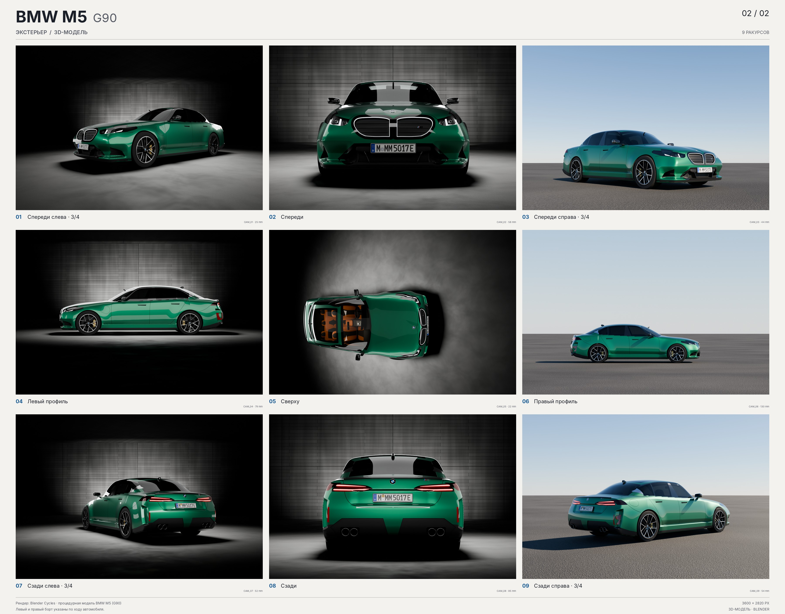

# BMW M5 (G90) — процедурная модель для Blender

Модель седана BMW M5 G90 в цвете Isle of Man Green, собранная целиком из кода
по девяти фотореференсам (спереди, сзади, оба профиля, сверху и четыре ракурса 3/4).
Готовая сцена — `bmw_m5_g90.blend` (сохранена в Blender 5.3, Cycles; ≈ 2,5 млн треугольников),
рендеры — в `renders/`.



Сравнение с референсами по каждому ракурсу — `renders/comparison.jpg`.

## Что внутри

| Часть | Как сделано |
|---|---|
| Кузов | Аналитическая поверхность: поля высот борта, верха, носа и хвоста с гладкими (C2) сопряжениями, поверх — «оранжерея» (лобовое, крыша, заднее стекло). Сетка — плотные квадраты строго на поверхности, нормали берутся из градиента функции, поэтому блики чистые при любой плотности. |
| Проёмы и зазоры | Булевы вырезы по контурам, снятым с референсов: арки, салонная полость, окна, зазоры капота, дверей, багажника и бамперов, лючки, ручки, ниши оптики, решётки и воздухозаборников. Каждый контур проецируется через камеру соответствующего снимка на поверхность кузова. |
| Остекление и оптика | Отдельные объёмные стёкла с разной тонировкой, линзы фар и фонарей, ходовые огни, светящийся контур решётки, световые полосы фонарей. |
| Навесные детали | Решётка с ламелями, зеркала с карбоновыми накладками, карбоновый спойлер, диффузор с четырьмя патрубками, антенна, эмблемы, шильдики M5, номерные знаки. |
| Колёса | 285/40 ZR20 и 295/35 ZR21: шины с протектором, двухцветные диски с двойными спицами, карбон-керамические тормоза с золотыми суппортами. |
| Салон | Спортивные сиденья, панель с изогнутым дисплеем, руль, консоль, дверные карты. |
| Сцена | Тёмная бетонная студия, софтбоксы, девять камер `CAM_01…CAM_09`, совпадающих с ракурсами референсов. |

Размеры реальные (метры): длина 5,096, ширина 1,970, высота 1,510, база 3,006.
Оси: +X вперёд, +Y влево по ходу, +Z вверх; начало координат — на земле посередине базы.

## Сборка

```bash
pip install bpy numpy scipy shapely pillow

# собрать модель и сохранить сцену
python3 build.py --quality final --out bmw_m5_g90.blend

# собрать и отрендерить все девять ракурсов
python3 build.py --quality final --render-quality preview --render renders
```

Или внутри Blender: `blender -b -P build.py -- --quality final --out bmw_m5_g90.blend`.

| `--quality` | Шаг сетки кузова | Граней кузова | Время сборки (4 CPU) |
|---|---|---|---|
| `draft` | 20 мм | ≈ 0,16 млн | ≈ 1,5 мин |
| `preview` | 11 мм | ≈ 0,33 млн | ≈ 3 мин |
| `final` | 6,5 мм | ≈ 0,74 млн | ≈ 7 мин |

Качество рендера (`--render-quality`): `draft` 960×640, `preview` 1920×1280, `final` 2880×1920.

## Структура

```
build.py            сборка: кузов → детали → колёса → салон → студия → рендер
m5g90/params.py     габариты, колёса, компоновка салона
m5g90/surf.py       поверхность кузова (все формообразующие кривые — здесь)
m5g90/mesher.py     сетка по неявной поверхности + релаксация
m5g90/cut.py        резцы, идущие по поверхности, булевы операции, восстановление нормалей
m5g90/features.py   контуры с референсов: окна, зазоры, оптика, решётка, диффузор
m5g90/details.py    решётка, зеркала, спойлер, выхлоп, эмблемы, номера
m5g90/wheels.py     колёса и тормоза
m5g90/interior.py   салон
m5g90/emblems.py    эмблемы, шильдики, номерные знаки
m5g90/scene.py      студия, камеры, рендер, контактные листы
m5g90/materials.py  библиотека материалов
```

Форму кузова правят в `surf.py` (опорные кривые в начале файла), расположение деталей —
в `features.py` (координаты сняты с фото, в метрах на плоскости снимка). После правки
достаточно пересобрать: проёмы и детали сами лягут на новую поверхность.

## Ограничения

Это узнаваемая, но не точная копия: модель собрана по девяти фотографиям, без чертежей
и сканов.

- **Пластика кузова упрощена.** Габариты, колёсная база, силуэт профиля и расположение
  окон, оптики, решётки, зазоров сверены наложением на референсы. Но гранёная лепка
  переднего и заднего бамперов, выштамповки капота и боковин переданы мягче, чем на
  настоящей машине, — на ракурсах 3/4 это заметно.
- **Передний бампер и диффузор** — упрощённые: воздухозаборник без внутренних рамок,
  диффузор — плоская чёрная накладка без рёбер.
- **Топология не «ручная».** Сетка кузова плотная и равномерная, после булевых вырезов —
  с треугольниками по кромкам. Для рендера и экспорта годится, под сабдив и ручную правку
  в режиме редактирования — нет.
- Двери, капот и багажник не открываются: зазоры — это канавки в едином кузове.
- Надписи на шинах нейтральные, шрифт номерного знака нарисован по образцу FE-Schrift,
  буквы шильдика M5 — наклонный Inter, не фирменный шрифт.
- Рендеры в `renders/` сняты в качестве `preview` (1920×1280, 64 сэмпла).
