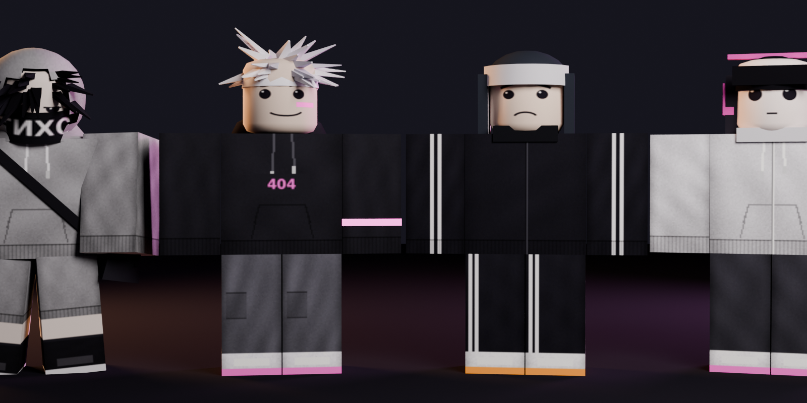

# СТРЕЛКА / STRELKA

**Концепт соревновательной Roblox-игры.** Двор на двор, 04:04 утра, одна колонка на всех.
У кого колонка — тот ставит музыку, и пока играет его трек, двор его. Каждый удар в игре
попадает в бит.

- Трейлер: [`render/strelka_trailer.mp4`](render/strelka_trailer.mp4)
- Персонажи и анимации: [`assets/`](assets) (`.blend`, FBX, текстуры), пайплайн — [`blender/`](blender/README.md)

---

## 0. Что я вижу в референсах

Пять картинок и два видео. По отдельности это разные вещи, вместе — одно и то же ощущение.

| Референс | Что в нём важно |
|---|---|
| Меню «Swag + Accessories» (PS2, скейт-игра) | Персонаж как вешалка для шмота. Хром, курсив, чёрная пустота. Экран выбора одежды — полноценная часть игры |
| Рука с телефоном, SMS «Зачислено зарплаты» | Постсоветский подъезд, дизеринг. **Интерфейс живёт внутри мира**: телефон вместо HUD. Один тёплый акцент (оранжевый) |
| Глитч-аниме, бело-розовое | Фигура как повреждённая запись: edge-detect, трекинг-крестики. Красота из артефактов носителя |
| Два R6-аватара в сером худи | Комьюнити-мода самого Roblox: капюшон, чёлка, маска, сумка через плечо. Почти монохром |
| «Ink Game — Roblox Animation» | Классические блочные аватары, снятые как кино: ключевой и контровой свет, малая глубина резкости |
| «A generic roblox fight animation» | R6 без локтей и коленей, вся игра — корпусом. Контровой свет, голландский угол, импакт-вспышка на каждом ударе |

Общий знаменатель, который я из этого вывожу:

1. **Почти монохром + один акцентный цвет.** Чёрное и хром + красный; коричневое + оранжевый; белое + розовый. Не «всё фиолетовое».
2. **Одинокая фигура в большом пустом месте.** Пустота — не недоделка, а настроение.
3. **Носитель виден.** Меню консоли, экран телефона, глитч записи. Интерфейс — часть картинки, а не слой поверх.
4. **Улица и подростковая субкультура**, а не фэнтези и не sci-fi.
5. Чего в референсах нет, но без чего этот вайб не существует — **музыки**. Вся эта эстетика в TikTok живёт под фонк. Отсюда главная механика ниже.

## 1. С чем я не согласен в исходной постановке

- **«Глубокий файтинг с точными таймингами».** В Roblox нет роллбэка, движение своего персонажа считает клиент, типичный пинг 60–200 мс, большая часть аудитории на телефонах. Тайминг «по анимации противника» при таком пинге превращается в лотерею и в авто-парри читы. Решение: точность измеряется не относительно противника, а относительно **общих часов — бита трека**. Часы у всех одинаковые, пинг перестаёт решать.
- **Асимметрия как в Dead by Daylight (1 против N).** Две очереди, все хотят одну роль, баланс двух разных игр, контент-конвейер. Для небольшой команды это ловушка. Решение: **вращающаяся асимметрия** — в каждый момент один убегает с колонкой, остальные гонятся, но роль меняется десятки раз за матч.
- **«Длинные комбо».** Комбо со стан-локом — это и есть Battlegrounds: весело бьющему, скучно битому. Здесь у защитника есть решение на каждой доле, оглушение не длиннее одной доли.
- **«Не прям файтинг».** Согласен, и довожу до конца: у игры нет полоски здоровья и нет убийств. Есть стойкость, нокдаун и подъём. Дерутся не «до смерти», а за предмет.
- **PS1-дизеринг.** После R6-референсов и видео я от него ушёл: в Roblox нет пользовательских шейдеров, честный low-res кадр там не сделать. Зато кинематографичный свет на блочных аватарах — достижим (Future-освещение, Atmosphere, ColorCorrection, DepthOfField).

## 2. Пять концепций

### 2.1 КОЛОНКА — keep-away в бит
- **Идея.** Две команды, одна портативная колонка. Команда, которая её держит, копит «эфир».
- **Loop.** Схватить → нести → отбиваться/убегать → потерять → отбирать. Матч = один трек.
- **Уникальное.** Все удары и защиты квантуются по долям трека. Два удара в одну долю по одной цели гасят друг друга.
- **Бой и движение.** Несущий не бьёт, только блок/уклон/бег. Остальные — уличная драка в бит + паркур по двору.
- **Глубина.** Чтение доли (сильная/слабая), маршруты, знание трека, игра в пас.
- **Визуал.** Ночной двор, единственный яркий розовый свет — колонка.
- **TikTok.** Любая запись уже «смонтирована под бит». Перехват на последней доле.
- **Риски.** Задержка звука на телефонах; порог входа для тех, кто «не слышит ритм».

### 2.2 КРУГ — раз на раз
- **Идея.** Дуэль в кругу, который образуют живые игроки. Победитель остаётся, следующий выходит.
- **Loop.** Очередь → вызов → бой 30–40 секунд → ставки зрителей → следующий.
- **Уникальное.** Зрители — не декорация: их шум даёт бойцу «поддержку», граница ринга — их тела.
- **Бой и движение.** Чистая дуэль, движения мало.
- **Глубина.** Высокая в дуэли, но узкая.
- **Визуал.** Толпа с телефонами-фонариками вокруг двух фигур — сильный кадр.
- **TikTok.** Нокауты, серии побед.
- **Риски.** Шестеро из восьми ждут. Это всё-таки «прям файтинг». Паркур не нужен.

### 2.3 ГАРАЖИ — догонялки по крышам
- **Идея.** Один «старший» ловит пятерых на гаражах, трубах и козырьках подъездов.
- **Loop.** Прятки → погоня → поимка → спасение пойманного.
- **Уникальное.** Вся карта — паркур-мебель русского двора.
- **Бой и движение.** Движение — всё, боя почти нет.
- **Глубина.** Маршруты и джуки.
- **Визуал.** Силуэты на крышах гаражей на фоне панелек.
- **TikTok.** Погони, прыжки «на грани».
- **Риски.** Та самая асимметрия 1 vs N со всеми её проблемами. Нет точного боя.

### 2.4 РАЙОН — открытый двор
- **Идея.** Большой район-песочница: тегай стены, держи точки, зови на разборки.
- **Loop.** Гулять → метить территорию → стычки → репутация.
- **Уникальное.** Постоянный мир, районы принадлежат командам.
- **Бой и движение.** Свободные, без структуры.
- **Глубина.** Социальная, не механическая.
- **Визуал.** Самый «атмосферный» вариант.
- **TikTok.** Ролевые сценки.
- **Риски.** Это Da Hood с русским скином: токсичность, гриферы, нет честного соревнования. Ровно то, чего вы не хотели.

### 2.5 ЗАБИВ — стенка на стенку по кодексу
- **Идея.** Раундовая командная драка, в которой уличные «понятия» — это правила игры.
- **Loop.** Сходка → раунд → подсчёт → смена стороны.
- **Уникальное.** «Лежачего не бьют», «толпой на одного — позор», вызов «раз на раз» внутри общей драки.
- **Бой и движение.** Драка в полный рост, движения мало.
- **Глубина.** Чтение противника + командная дисциплина.
- **Визуал.** Две шеренги в тумане.
- **TikTok.** Камбэки «один остался против троих».
- **Риски.** Выбывшие смотрят в потолок. Без цели, кроме «уронить всех», быстро приедается.

### Сравнение

| | Оригинальность | Движение | Точный бой | Все заняты всё время | Реализуемость | TikTok |
|---|---|---|---|---|---|---|
| КОЛОНКА | ●●●● | ●●●● | ●●●● | ●●●● | ●●● | ●●●● |
| КРУГ | ●● | ● | ●●●● | ● | ●●●● | ●●● |
| ГАРАЖИ | ●● | ●●●● | ● | ●●● | ●●● | ●●● |
| РАЙОН | ● | ●● | ●● | ●●● | ●● | ●● |
| ЗАБИВ | ●●● | ●● | ●●● | ●● | ●●●● | ●●● |

**Выбор: КОЛОНКА как ядро**, с кодексом из «Забива» и вызовом «раз на раз» из «Круга» как редким моментом внутри матча. Причины:

1. Это единственный вариант, где слабость платформы (пинг) перестаёт быть проблемой для точного боя.
2. Погоня и драка — один цикл, а не два режима. Никто не сидит в зрителях.
3. Запись матча сама ложится на музыку — виральность возникает из механики, а не из «красивой оболочки».
4. Контент — это треки, а не герои. Трек дешевле героя и при этом меняет игру сильнее.

---

## 3. СТРЕЛКА: подробный дизайн

### 3.1 Питч
4 на 4, один двор, один трек длиной 2:40–3:20. В центре двора лежит колонка. Пока её несёт твоя команда —
играет твой трек и капает **эфир**. Отобрать колонку можно, только уронив несущего или выбив её ударом.
Все удары, блоки и уклоны срабатывают **на долю**. Когда трек заканчивается, побеждает команда с большим эфиром.

Режимы: 4v4 (основной), 3v3 (рейтинг), 2v2, «Раз на раз» 1v1, «Прогон» — соло-паркур под трек на время.

### 3.2 Бит-сетка
- Сервер знает время старта трека. Номер доли = `floor((workspace:GetServerTimeNow() - start) / beatLen)`.
- **Удар**: нажал — персонаж замахивается, попадание происходит ровно на следующей доле (замах = 1 доля, 360–430 мс при 140–165 BPM). Этого хватает, чтобы среагировать даже с пингом.
- **Защита**: блок/уклон засчитывается, если нажат в окне ±70 мс от доли. Окно считается по синхронным часам клиента, сервер проверяет правдоподобие.
- Сервер разрешает долю с задержкой в одну восьмую (~190 мс): пакеты успевают дойти, а вердикт (искры, импакт-кадр) визуально приходится на слабую долю — «удар в долю, ответ на „и“».
- Дистанцию объявляет атакующий, сервер проверяет с допуском. Убежать из-под удара за одну долю можно — это и есть движение как защита.

### 3.3 Драка
Здоровья нет. Есть **стойкость**: каждый пропущенный удар её снимает, вне боя она восстанавливается.
Стойкость в ноль — **нокдаун** на 2 такта (товарищ может поднять за одну долю).

| Действие | Тайминг | Что делает | Чем наказывается |
|---|---|---|---|
| **Двойка** | джеб на «и», кросс в сильную долю | основной урон по стойкости | блок в долю |
| **Размах** | замах с «и», попадание в *слабую* долю | тяжёлый, пробивает ранний блок | уклон в ту же слабую долю; сам замах долгий |
| **С ноги** | в сильную долю | толчок: ломает блок, выбивает колонку из рук, сбрасывает с крыши | уклон → противник открыт на 1 долю |
| **Блок** | в долю | гасит двойку, атакующий «звенит» 1 долю | удар с ноги, размах |
| **Уклон** | в долю | полный промах атакующего + право первой доли | два уклона подряд не работают |
| **Финт** | отмена замаха | выманивает блок | стоит «хода» (скорости) |

Одно действие на долю — спамить нечем. Промах стоит скорости. Клип каждого действия в `assets/` размечен именно так.

### 3.4 Кодекс двора (правила как механика)
- **Лежачего не бьют.** В нокдауне игрок неуязвим. Нет добивания, нет «фарма» упавших.
- **Толпой — мешаете друг другу.** Два удара по одной цели в одну долю гасятся, оба атакующих «звенят». Чтобы давить вдвоём, надо бить *по очереди*, через долю — это требует сыгранности. А ещё можно специально попасть в долю чужого удара и испортить его.
- **Несущий не бьёт.** Руки заняты. Он блокирует, уклоняется, бежит или пасует.
- **Раз на раз.** Раз в такт можно вызвать конкретного противника. Принял — на 4 такта вокруг них круг, остальные не вмешиваются (вмешался — сам в нокдаун). Победитель забирает колонку, где бы она ни была. Отказался — команда теряет немного эфира. Редкий, громкий момент.

### 3.5 Движение
- **Ход** — множитель скорости 0–4. Растёт, когда связываешь приёмы без остановки, падает от промахов и нокдаунов.
- Приёмы: подкат, прыжок от стены, бег по гаражам, перемах через лавку и капот, раскачка на турнике, бег по теплотрассе, залаз на козырёк подъезда, сквозные подъезды (вход во двор — выход на крышу).
- **Прыжок и приземление в долю** дают небольшой буст хода. Не обязательно, но сильные игроки будут «играть» маршрут под трек.
- Несущий получает эфир ×ход. Прятаться в углу невыгодно — выгодно красиво бежать.
- Каждые 8 тактов во дворе загорается **освещённая зона** (фонари, окна). Эфир там ×2. Несущему приходится идти туда, где его ждут.

### 3.6 Матч = трек
| Часть трека | Что меняется |
|---|---|
| Интро (8–16 тактов) | Колонка лежит в центре, трек «протекает» из неё. Команды сходятся. Время набрать ход |
| Куплет | Обычные правила |
| Дроп | Эфир ×2, размах не стоит хода. Двор мигает в бит |
| **ШУХЕР** (8 тактов, середина) | Музыка обрывается. Мигалки, фонари гаснут, имена и метроном скрыты. Сетка долей *остаётся* — но держать её надо в голове. Кто попал под луч — в нокдаун. Несущий, которого не нашли, получает ×3 |
| Финальный дроп | Эфир ×2. Кто держит колонку **на последней доле трека** — бонус 15% |

Последняя доля известна всем заранее. Это гарантированная кульминация каждого матча.

### 3.7 Что отличает сильного игрока
- Внутренний метроном: блок в долю в полной тишине «шухера».
- Знание трека: где сбивка, где дроп, где зона загорится через 4 такта.
- Чтение сильной/слабой доли по замаху и по звуку.
- Маршруты: связки приёмов, которые ложатся на бит и не теряют ход.
- Командная игра: бить через долю, пас в долю, перехват паса, охрана несущего.
- Управление последней долей.

Сотни часов уходят на связку «трек × двор × состав». Новый трек — это новая «временна́я карта» поверх той же геометрии.

### 3.8 Доступность
- Визуальный метроном везде: кольцо под ногами, пульс фонарей, четыре квадрата на экране телефона. Играть можно без звука.
- «Автосинк» по умолчанию: нажатия рядом с долей притягиваются к ней, но дают только «хорошо», не «идеально». В рейтинге на высоких рангах его выключают.
- Калибровка задержки звука (Bluetooth, мобильные) — первым экраном.
- «Прогон»: соло-маршрут под трек на очки. Безопасный вход и отдельный формат контента.

### 3.9 Визуальная идентичность
1. Двор почти чёрно-серый с натриевым оранжевым. **Единственный розовый свет — колонка.** По скриншоту всегда видно, где игра.
2. Игроки приходят **со своими аватарами**, тип аватара принудительно R6. Мода комьюнити (худи, капюшон, маска, сумка) — это и есть арт-дирекшн персонажей.
3. HUD — кнопочный телефон в руке: палки сети, счёт эфира приходит SMS-кой «Зачислено: 12.4 с эфира», в «шухер» — «НЕТ СЕТИ».
4. Попадание = импакт-кадр: белая пустота, контуры тушью, розовые трекинг-крестики.
5. Меню шмота — хромированное Y2K-меню «как на консоли 2004 года».
6. Лобби — освещённый ларёк «Эфир 24 часа» и лавочка. То самое «странное уютное».

### 3.10 TikTok
- Клип любого момента уже синхронен с музыкой.
- После матча игра собирает «кассету»: три лучших момента (серия блоков подряд, перехват на последней доле, длинный пронос) повтором с кинокамерой, в вертикальном кадре.
- Трек недели выходит и как звук — ролики под него ведут обратно в игру.
- Эмоции в лобби идут от общих часов: весь сервер танцует синхронно без договорённостей.

### 3.11 Почему возвращаться
Рейтинг 3v3 и дуэли, ротация треков («эфир недели»), мастерство по каждому треку, таблицы «Прогона» с призраками, косметика (только шмот, никакой силы за деньги).

## 4. Реализация в Roblox

| Задача | Как |
|---|---|
| Общие часы | `workspace:GetServerTimeNow()`; звук стартует локально и подгоняется по `Sound.TimePosition` |
| Разрешение долей | серверный цикл на `RunService.Heartbeat`; действия — `RemoteEvent` с номером доли, телеметрия позиций — `UnreliableRemoteEvent` |
| Анимации | клипы размечены в долях; `AnimationTrack:AdjustSpeed(bpm / 150)` держит их на сетке при любом темпе |
| Аватары | тип аватара R6 в настройках игры; свои анимации заменяют стандартный `Animate` |
| Движение | свой контроллер на клиенте (сеть владеет персонажем локально — отклик мгновенный), сервер проверяет скорость и телепорты |
| Античит | сервер не рассылает то, чего человек не видит (финт неотличим от удара до доли); статистика «нечеловечески ровных» таймингов |
| Свет | Future lighting, Atmosphere, Bloom, ColorCorrection, DepthOfField; пульс — на нескольких общих источниках, а не на сотне ламп |
| Телефон-HUD | `SurfaceGui` на модели телефона в руке от первого лица / `ViewportFrame` в углу |
| Повторы | кольцевой буфер CFrame + события анимаций на 20 Гц, проигрывание на манекенах |

Ограничения, о которых стоит знать заранее:
- **Музыка** должна быть своей или лицензированной. Это и риск, и возможность: андеграунд-продюсеры — готовый канал в сообщество.
- **Модерация**: уличная тема проходит, если нет крови, табака, алкоголя, реальных брендов и политической символики. Сигаретная иконка из референса в игру не идёт. «Шухер» — безличные мигалки, без формы и лиц.
- **Задержка звука** на Android и Bluetooth непостоянна. Поэтому визуальный метроном — основной, звук — подтверждение.

## 5. Риски и план проверки

| Риск | Проверка / критерий остановки |
|---|---|
| Синхронизация бита «плывёт» на телефонах | Прототип за 2–3 недели: серый бокс, два игрока, удар/блок по сетке. Если после калибровки ошибка >40 мс на типичных телефонах — расширять окна или уводить точность в визуальный метроном |
| Ритм отпугивает часть игроков | Автосинк, «Прогон», боты в первых матчах. Метрика: доля новичков, сделавших ≥1 блок в долю за первый матч |
| Командный режим пуст на старте | Запускать с 2v2 и «Прогоном», 4v4 включать при онлайне |
| «Раз на раз» создаёт простой | Он редкий (раз в такт на команду), короткий (4 такта) и добровольный. Если мешает — убрать, ядро от него не зависит |
| Контент | 1 двор + 3 трека на запуск. Дальше — трек в неделю |

## 6. Что лежит в репозитории

- `assets/strelka_characters.blend` — четыре оригинальных R6-аватара (ТИХИЙ, ГРАЧ, ЗИМА, МОЛЬ) и 24 анимации.
- `assets/fbx/*.fbx` — то же по одному файлу на персонажа, все анимации внутри, текстуры встроены.
- `assets/strelka_trailer.blend` — сцена трейлера целиком.
- `render/strelka_trailer.mp4` — трейлер, 21 с, 160 BPM, каждый удар в бит.
- `blender/` — скрипты: всё строится процедурно одной командой.

Честные оговорки:
- Аватары **созданы с нуля в стиле R6**, а не скачаны: вещи из каталога Roblox принадлежат их авторам, и класть их в репозиторий нельзя. В самой игре это и не нужно — игрок приходит в своём аватаре. Если дадите ник, свой аватар можно выгрузить через публичный API Roblox и посадить на этот же риг.
- Импорт FBX и анимаций в Roblox Studio **не проверялся** (Studio здесь нет). Проверено только, что FBX читается обратно в Blender: риг из 6 частей с именами R6, 24 дубля, текстуры.
- Оба видео-референса я видел только по превью и раскадровке, не целиком.
